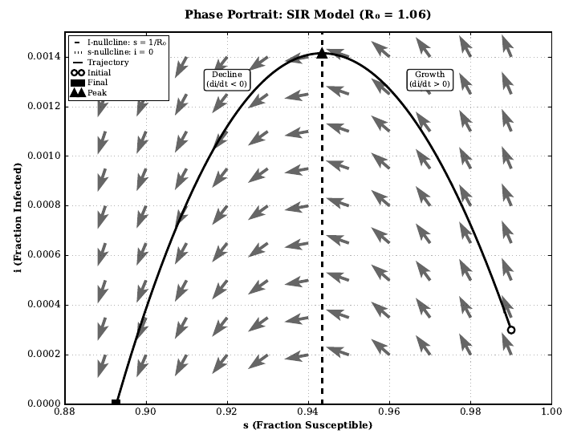
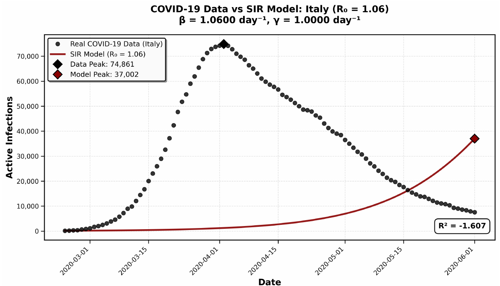

# COVID-19 Dynamics with the SIR Model

Final paper for MATH 3440 (Nonlinear Systems and Modeling) at Seattle University, December 2025.

I used methods from nonlinear dynamics to analyze the SIR (Susceptible-Infected-Recovered) model and compared it with Italy's COVID-19 data from the first outbreak (February 21 to May 31, 2020, from Our World in Data).

**Paper:** [COVID-19_SIR_Model_Analysis.pdf](COVID-19_SIR_Model_Analysis.pdf)

## What's covered

- Fixed points and linear stability using the Jacobian and its eigenvalues
- The transcritical bifurcation at R0 = 1 that separates outbreak from extinction
- Phase plane analysis: nullclines, trajectories, and why the I-nullcline sets the time of peak infection
- The trajectory equation I(S) and the final size relation
- Herd immunity threshold as a function of R0
- Fitting the model to Italy's data and looking at where it fails

## Result

The basic SIR model could not predict Italy's outbreak. The fit (R0 = 1.06) badly underestimates the early exponential growth, because a model with constant parameters can't account for the lockdown and other interventions.

I followed up on this in my [numerical methods project](https://github.com/Kyler-Kasravi/Numerical-Methods-Project), where an SEIR model with a time-varying transmission rate does capture the lockdown.

## References

- Strogatz, *Nonlinear Dynamics and Chaos*, 2nd ed.
- Keeling and Rohani, *Modeling Infectious Diseases in Humans and Animals*
- Kermack and McKendrick (1927)
